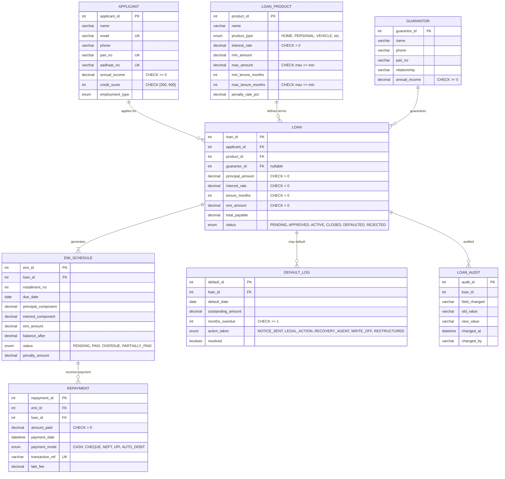

# 🏦 Bank Loan Management System: EMI Processing, Repayment Tracking, and Risk Assessment

> A comprehensive, enterprise-grade Database Management Systems (DBMS) course project: modeling the complete retail and commercial lending lifecycle, reducing-balance EMI amortization schedules, active default detection, and risk analytics.

-blue?logo=mysql&logoColor=white)
-green?logo=python&logoColor=white)


-darkblue?logo=latex&logoColor=white)


---

## 📋 Problem Statement & Objectives

Commercial banks and financial institutions process thousands of loan applications spanning diverse portfolios (*Home, Personal, Vehicle, Education, Business, Gold, Agriculture*). Traditional ledger maintenance suffers from:
1. **Lack of ACID Transaction Safety:** Concurrency race conditions when multiple payment channels (UPI, auto-debit, cheque) attempt simultaneous installment settlement.
2. **Amortization Inaccuracies:** Manual rounding drift in reducing-balance monthly interest calculations across long tenures (up to 360 months).
3. **Delayed Default Identification:** Failure to track Special Mention Accounts (SMA-0, SMA-1, SMA-2) leading to unmitigated Non-Performing Assets (NPAs).
4. **Data Redundancy & Anomalies:** Denormalized loan ledgers causing insertion, update, and deletion anomalies.

**This project solves these challenges through:**
- **Normalized Relational Architecture (BCNF):** 8 tables with zero redundancy and strict referential integrity.
- **Automated Reducing-Balance EMI Engine:** Stored procedure computing principal/interest breakdown with zero residual balance.
- **Pessimistic Locking & ACID Compliance:** Two-phase locking (`SELECT ... FOR UPDATE`) preventing double repayments.
- **Event-Driven Risk Automation:** Triggers classifying loans as `DEFAULTED` (90-day overdue rule) and logging SARFAESI actions.
- **Interactive Full-Stack Web Application:** Visual query inspection with a dedicated "How It Works" modal.

---

## 🏗️ Project Architecture & Directory Layout

```
dbms-bank-loan-system/
├── sql/
│   ├── schema.sql               ← Stage 2: 8 Tables, PK/FK, CHECKs, ENUMs (InnoDB)
│   ├── seed.sql                 ← Stage 3: 80 applicants, 10 products, 120 loans, 4000+ EMIs
│   ├── queries.sql              ← Stage 4: 10 analytical queries, views, relational algebra
│   ├── normalization.sql        ← Stage 5: LOAN_RAW → 1NF → 2NF → 3NF → BCNF decomposition
│   ├── procedures_triggers.sql  ← Stage 6: ACID procedures, overdue triggers, audit trail
│   └── indexes_concurrency.sql  ← Stage 7: B+ tree indexes, EXPLAIN plans, 2-session locking
├── scripts/
│   └── generate_seed.py         ← Deterministic Python Faker script (seed=42) generating seed.sql
├── backend/
│   ├── app.py                  ← Flask REST API connecting frontend to MySQL bank_loan_db
│   └── requirements.txt         ← flask, flask-cors, mysql-connector-python
├── frontend/
│   ├── index.html               ← LoanFlow Portal UI with live EMI calculator & "How It Works"
│   ├── styles.css               ← Dark glassmorphic banking theme
│   └── app.js                   ← Amortization calculator, search, live REST API client
├── docs/
│   ├── er-design.md             ← Comprehensive ER documentation, data dictionary, viva Q&A
│   └── report.tex               ← Complete LaTeX project report adhering to college template
└── README.md                    ← You are here
```

---

## 🗺️ Entity-Relationship (ER) Diagram



---

## 🗄️ Relational Schema Summary (8 Tables)

| Table | Primary Key | Foreign Keys | Key Constraints & Integrity Rules |
|-------|-------------|--------------|-----------------------------------|
| `APPLICANT` | `applicant_id` | — | `email` UNIQUE, `pan_no` UNIQUE, `aadhaar_no` UNIQUE, `credit_score BETWEEN 300 AND 900`, `annual_income >= 0` |
| `LOAN_PRODUCT` | `product_id` | — | `interest_rate > 0`, `max_amount >= min_amount`, `max_tenure >= min_tenure`, `penalty_rate_pct >= 0` |
| `GUARANTOR` | `guarantor_id` | — | `annual_income >= 0` |
| `LOAN` | `loan_id` | `applicant_id`, `product_id`, `guarantor_id` | `principal_amount > 0`, `emi_amount > 0`, `total_payable >= principal`, `ON DELETE RESTRICT` (Applicant/Product), `ON DELETE SET NULL` (Guarantor) |
| `EMI_SCHEDULE` | `emi_id` | `loan_id` | `UNIQUE(loan_id, installment_no)`, `principal + interest = emi`, `balance_after >= 0`, `ON DELETE CASCADE` |
| `REPAYMENT` | `repayment_id` | `emi_id`, `loan_id` | `amount_paid > 0`, `transaction_ref` UNIQUE, `late_fee >= 0`, `ON DELETE RESTRICT` (Immutable ledger) |
| `DEFAULT_LOG` | `default_id` | `loan_id` | `months_overdue >= 1`, `outstanding_amount > 0`, `ON DELETE RESTRICT` |
| `LOAN_AUDIT` | `audit_id` | `loan_id` | Immutable forensic log populated via database triggers |

---

## 📐 Mathematical Formulation of EMI (Reducing Balance Method)

For a principal $P$, monthly interest rate $r = \frac{\text{Annual Rate}}{12 \times 100}$, and tenure $n$ months, the monthly installment $E$ is:

$$E = P \cdot \frac{r(1+r)^n}{(1+r)^n - 1}$$

For each installment $k \in \{1, 2, \dots, n\}$:
- **Interest Component:** $I_k = B_{k-1} \cdot r$
- **Principal Component:** $P_k = E - I_k$
- **Remaining Balance:** $B_k = B_{k-1} - P_k$ where $B_0 = P$ and $B_n \equiv 0.00$

---

## 🚀 How to Run the Complete Project

### Prerequisites
- **MySQL 8.0+** installed and running on port 3306
- **Python 3.8+** with `faker`, `flask`, `flask-cors`, and `mysql-connector-python`
- Modern web browser (Chrome, Edge, Firefox)

### Step-by-Step Execution Guide

```bash
# 1. Clone repository
git clone https://github.com/YOUR_USERNAME/bank-loan-management-system.git
cd bank-loan-management-system

# 2. Initialize Database & Tables in MySQL
mysql -u root -p < sql/schema.sql

# 3. Generate & Load Synthetic Seed Data
pip install -r backend/requirements.txt
pip install faker
python scripts/generate_seed.py
mysql -u root -p bank_loan_db < sql/seed.sql

# 4. Execute Queries, Procedures, Triggers, and Indexes
mysql -u root -p bank_loan_db < sql/queries.sql
mysql -u root -p bank_loan_db < sql/procedures_triggers.sql
mysql -u root -p bank_loan_db < sql/indexes_concurrency.sql

# 5. Start the RESTful Flask Backend
cd backend
python app.py
# Server runs on: http://localhost:5000

# 6. Access the Application
# Open http://localhost:5000 in your browser
# The frontend connects to MySQL with live query demonstrations!
```

---

## 📊 Core Analytical Queries & Views

1. **Overdue Loans Report:** Consolidates delinquent borrowers, overdue installment counts, and total overdue demand (`JOIN` + `GROUP BY` + `HAVING`).
2. **Portfolio-wise Outstanding Analysis:** Aggregates disbursed capital, active debt exposure, and NPA rates across loan product types.
3. **Defaulter List (RBI NPA Norms):** Identifies accounts with $\ge 3$ consecutive unpaid EMIs (90+ day delinquency).
4. **Monthly Collection Efficiency:** Measures recovery percentage: $\frac{\text{Amount Collected}}{\text{Amount Due}} \times 100$.
5. **Aging Analysis (SMA Buckets):** Classifies overdue loans into SMA-0 (1-30 days), SMA-1 (31-60 days), SMA-2 (61-90 days), and NPA (90+ days).

---

## 🎓 Viva Voce & Defense Cheat Sheet

1. **Why MySQL 8.0 and InnoDB?**
   - MySQL 8.0 strictly enforces `CHECK` constraints (MySQL 5.7 ignored them). InnoDB guarantees ACID transactions, row-level exclusive locking (`SELECT ... FOR UPDATE`), and foreign key referential integrity.
2. **Why `DECIMAL(12,2)` instead of `FLOAT` or `DOUBLE`?**
   - Floating-point representations introduce binary fractional approximations (IEEE 754). `DECIMAL` provides exact fixed-point base-10 arithmetic mandatory for financial ledgers.
3. **How is double repayment prevented under high concurrency?**
   - The stored procedure `process_repayment()` uses pessimistic locking (`SELECT ... FOR UPDATE`) on the target installment row, forcing concurrent webhooks into lock waits until the first transaction commits.
4. **Why B+ Trees for financial databases?**
   - High fan-out (1,000+ keys per 16 KB page) limits tree height to 3 levels, ensuring $\mathcal{O}(\log_B N)$ lookup. Doubly-linked leaf nodes enable ultra-fast range queries for date-bound reporting.
5. **How does normalization prevent anomalies?**
   - Decomposing the universal relation `LOAN_RAW` into 8 BCNF tables isolates functional dependencies, eliminating redundant multi-installment customer attributes and preventing insertion, update, and deletion anomalies.

---

## 📜 Academic Attribution
- **Course:** A9511 - Database Management Systems (B.Tech CSE)
- **Institution:** Vardhaman College of Engineering, Hyderabad
- **Course Facilitator:** Dr. Reddy Saisindhutheja, Associate Professor
