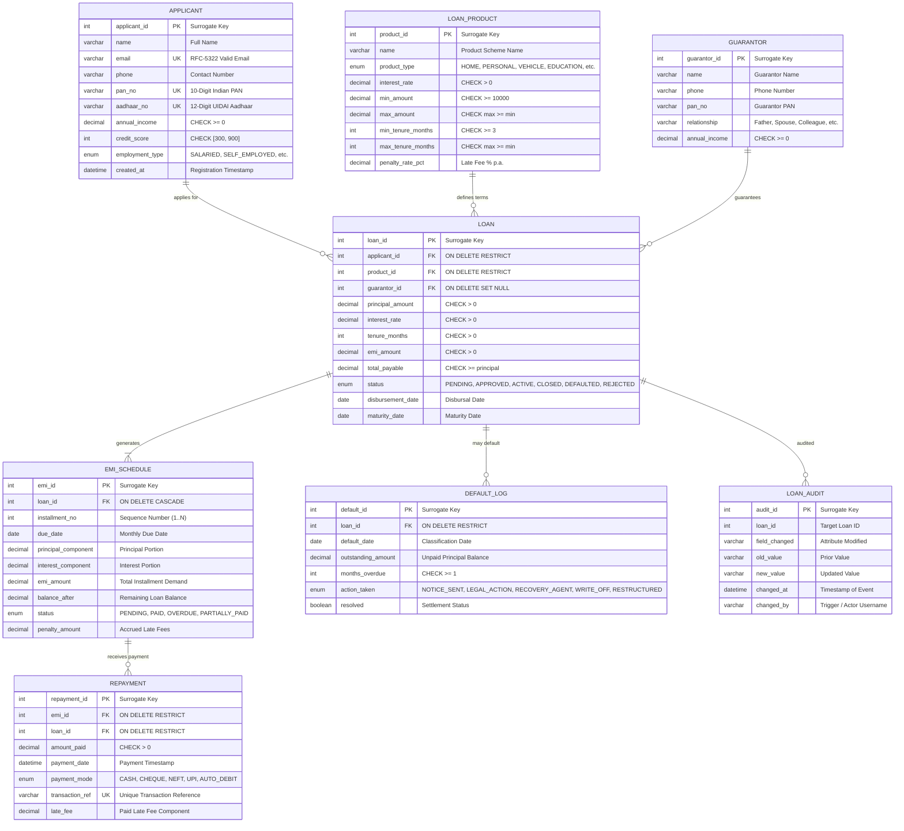

# 🏦 Bank Loan Management System: EMI Processing, Repayment Tracking, and Risk Assessment
### A DBMS Complex Engineering Case Study & Course End Project

[](https://github.com/Bhanu-teja-VCE/dbms-course-end-project)
[-00758F?logo=mysql&logoColor=white)](https://www.mysql.com/)
[-3776AB?logo=python&logoColor=white)](https://www.python.org/)
[](https://flask.palletsprojects.com/)
[](#frontend-application-preview)
[-008080?logo=latex&logoColor=white)](docs/report.tex)
[](#regulatory-compliance)

---

## 📌 Executive Summary & Case Study Overview

This repository contains the complete implementation, database architecture, backend API, interactive dashboard, and academic documentation for the **Course End Project (CEP) / Complex Engineering Problem (CEP) Case Study** for:
- **Course**: `A9511 - Database Management Systems`
- **Institution**: Department of Computer Science and Engineering, **Vardhaman College of Engineering, Hyderabad**
- **Course Facilitator**: **Dr. Reddy Saisindhutheja**, Associate Professor
- **Student Lead**: **Bhanu Teja**

### Problem Statement:
> *"Design and implement a relational database for loan applicants, loan products, guarantors, EMIs, repayments, and defaults. Implement automated EMI schedule generation and write production-grade analytical queries for overdue loans, portfolio-wise outstanding exposure, and defaulter tracking under RBI guidelines."*

### Key Analysis Dimensions Addressed:
1. **Relational Associations & Integrity**: Complex multi-party relationships among `APPLICANT`, `LOAN_PRODUCT`, `GUARANTOR`, `LOAN`, `EMI_SCHEDULE`, and `REPAYMENT`.
2. **Reducing-Balance Amortization Mathematics**: Automated algorithmic splitting of each installment into principal and interest components with exact zero residual balance ($B_n \equiv 0.00$).
3. **Handling Multi-Channel Payments & Penalty Rules**: ACID transaction handling of partial, late, and advance payments, including automated delay fee computation.
4. **Delinquency, Risk & Portfolio Analytics**: Dynamic grouping and analytical views for overdue accounts, portfolio exposure aggregation, and automated Non-Performing Asset (NPA) classification (RBI 90-day overdue rule).

---

## 📁 Repository Contents & Deliverables

Every file required for demonstration, evaluation, and grading is present in this repository:

| Directory / File | Description | Academic Relevance |
| :--- | :--- | :--- |
| **[`sql/schema.sql`](sql/schema.sql)** | Complete DDL script for all 8 tables in MySQL 8.0 (InnoDB) with `CHECK`, `UNIQUE`, `ENUM`, and `ON DELETE` rules. | **Stage 2: Schema Design** |
| **[`sql/seed.sql`](sql/seed.sql)** | Synthetic production seed script (80 applicants, 10 products, 40 guarantors, 120 loans, 4,188 EMIs, 200 payments). | **Stage 3: Data Generation** |
| **[`scripts/generate_seed.py`](scripts/generate_seed.py)** | Deterministic Python generator using `Faker('en_IN')` (`seed=42`) calculating exact reducing-balance amortization schedules. | **Reproducibility & Verification** |
| **[`sql/queries.sql`](sql/queries.sql)** | 10 complex analytical queries, 2 views (`overdue_emi_view`, `loan_portfolio_summary_view`), and Relational Algebra formulations ($\pi, \sigma, \gamma, \bowtie$). | **Stage 4: Unit II Queries** |
| **[`sql/normalization.sql`](sql/normalization.sql)** | Deliberately unnormalized `LOAN_RAW` table, anomaly demonstrations, Armstrong's attribute closure proof, and 1NF $\rightarrow$ 2NF $\rightarrow$ 3NF $\rightarrow$ BCNF decomposition. | **Stage 5: Normalization** |
| **[`sql/procedures_triggers.sql`](sql/procedures_triggers.sql)** | Stored procedures (`generate_emi_schedule`, `process_repayment`, `mark_overdue_emis`, `get_loan_summary`) and reactive triggers for default logging and audit capture. | **Stage 6: Unit IV Procedural SQL** |
| **[`sql/indexes_concurrency.sql`](sql/indexes_concurrency.sql)** | B+ tree secondary/composite indexes, `EXPLAIN ANALYZE` benchmarks, two-session pessimistic locking (`SELECT ... FOR UPDATE`), and deadlock analysis. | **Stage 7: Unit V Query Optimization** |
| **[`backend/app.py`](backend/app.py)** | Production Flask RESTful backend service with live MySQL integration and dual-mode resilient fallback. | **System Architecture** |
| **[`frontend/`](frontend/)** | Interactive Single Page Application (SPA) dashboard with real-time EMI calculator, loan application modal, and the **"How It Works" SQL inspector**. | **System Demonstration** |
| **[`docs/report.tex`](docs/report.tex)** | **Complete Course End Project Report** written in LaTeX adhering strictly to the Vardhaman College of Engineering report template. | **Academic Report** |
| **[`docs/er-design.md`](docs/er-design.md)** | Exhaustive Entity-Relationship documentation, data dictionary, cardinality analysis, and **12 viva defense Q&As**. | **Stage 1 & Viva Preparation** |
| **[`docs/realtime_analytics_report.tex`](docs/realtime_analytics_report.tex)** | Supplementary research case study on *Real-Time Analytics Using Materialized Views and Incremental Data Refresh*. | **Comparative Research Case Study** |
| **[`sql/materialized_views_leaderboard.sql`](sql/materialized_views_leaderboard.sql)** | Benchmark SQL script comparing plain views, materialized views, and trigger-based incremental summary tables. | **Comparative Research Implementation** |

---

## 🗺️ Entity-Relationship (ER) Architecture

The relational schema is modeled in Third Normal Form (3NF) and Boyce-Codd Normal Form (BCNF), avoiding data redundancy:



---

## 📐 Mathematical Formulation of EMI (Reducing Balance Method)

In banking systems, all retail loans follow the **reducing-balance amortization formula** rather than flat interest rates.

Given:
- Sanctioned Principal $P$
- Annual Interest Rate $R\%$
- Monthly Rate $r = \frac{R}{12 \times 100}$
- Loan Tenure $n$ (months)

The Equated Monthly Installment ($E$) is derived from the boundary condition that the terminal balance after $n$ installments must equal zero ($B_n = 0$):

$$E = P \cdot \frac{r(1+r)^n}{(1+r)^n - 1}$$

For each installment month $k \in \{1, 2, \dots, n\}$:
$$\text{Interest Component: } I_k = B_{k-1} \cdot r$$
$$\text{Principal Component: } P_k = E - I_k$$
$$\text{Remaining Balance: } B_k = B_{k-1} - P_k \quad \text{where } B_0 = P \text{ and } B_n \equiv 0.00$$

---

## 🛠️ Step-by-Step Installation & Execution Guide

### 1. Prerequisites
- **MySQL Server 8.0+** (running on port 3306)
- **Python 3.8+** with `pip`
- Modern Web Browser (Chrome, Edge, Firefox)

### 2. Database Initialization
Open PowerShell or your terminal and execute:
```bash
# Clone the repository
git clone https://github.com/Bhanu-teja-VCE/dbms-course-end-project.git
cd dbms-course-end-project

# Initialize Database Schema
mysql -u root -p < sql/schema.sql

# Load the Pre-generated Synthetic Seed Data (4,188 EMIs, 120 Loans)
mysql -u root -p bank_loan_db < sql/seed.sql

# Load Analytical Queries and Views
mysql -u root -p bank_loan_db < sql/queries.sql

# Load Stored Procedures, Triggers & Cursors
mysql -u root -p bank_loan_db < sql/procedures_triggers.sql

# Load B+ Tree Indexes & Benchmark Tests
mysql -u root -p bank_loan_db < sql/indexes_concurrency.sql
```

*(Optional)* To re-generate custom synthetic seed data with Python:
```bash
pip install faker
python scripts/generate_seed.py
```

### 3. Launch the Web Application
```bash
# Install backend dependencies
pip install -r backend/requirements.txt

# Start the Flask REST API server
cd backend
python app.py
```
Open **`http://localhost:5000`** in your browser. The web interface will automatically connect to your MySQL database. If the database is offline, it gracefully falls back to interactive demo mode while continuing to show all underlying SQL queries!

---

## 📊 Core Analytical Queries & RBI Risk Compliance

The project implements comprehensive SQL queries reflecting actual banking operational standards:

1. **Overdue Loans Report (`queries.sql - Query 1`)**:
   Uses multi-table `JOIN`, `GROUP BY`, and `HAVING` to locate borrowers with overdue EMIs, calculating overdue counts and cumulative unpaid demands.
2. **Portfolio-Wise Outstanding Amount (`queries.sql - Query 2`)**:
   Aggregates total capital disbursed, active debt exposure, collected revenue, and default ratios across loan portfolios (*Home, Personal, Vehicle, Education, Business, Gold, Agriculture*).
3. **Defaulter List under RBI NPA Norms (`queries.sql - Query 3`)**:
   Implements a correlated subquery identifying borrowers with $\ge 3$ consecutive overdue installments (the RBI 90-day delinquency threshold).
4. **Monthly Collection Efficiency (`queries.sql - Query 4`)**:
   Calculates recovery efficiency using $\frac{\text{Amount Collected}}{\text{Amount Due}} \times 100$ grouped by billing month.
5. **Delinquency Aging Analysis (`queries.sql - Query 10`)**:
   Classifies overdue debts into prudential Special Mention Account (SMA) buckets:
   - **SMA-0**: 1 to 30 days overdue
   - **SMA-1**: 31 to 60 days overdue
   - **SMA-2**: 61 to 90 days overdue
   - **NPA**: $> 90$ days overdue (Statutory Default)

---

## 🎓 Academic Viva Voce & Defense Questions

<details>
<summary><b>1. Why choose MySQL 8.0 and the InnoDB Storage Engine?</b></summary>
<br>
<b>Answer:</b> MySQL 8.0 strictly parses and enforces <code>CHECK</code> constraints (unlike MySQL 5.7, which parsed them but ignored enforcement). InnoDB was chosen because it guarantees full ACID compliance, row-level exclusive locking (<code>SELECT ... FOR UPDATE</code>), crash recovery via Write-Ahead Logging (WAL/redo log), and strict foreign key referential integrity.
</details>

<details>
<summary><b>2. Why use <code>DECIMAL(12,2)</code> instead of <code>FLOAT</code> or <code>DOUBLE</code>?</b></summary>
<br>
<b>Answer:</b> <code>FLOAT</code> and <code>DOUBLE</code> utilize IEEE 754 floating-point binary approximations, which cause cumulative rounding errors in financial transactions. <code>DECIMAL(12,2)</code> is an exact, fixed-point numeric representation where values are stored as base-10 digits, eliminating fractional penny drift across 360-month loan terms.
</details>

<details>
<summary><b>3. How does the system prevent double repayment under concurrent requests?</b></summary>
<br>
<b>Answer:</b> The procedure <code>process_repayment()</code> wraps execution inside an ACID transaction and applies pessimistic row-level locking using <code>SELECT ... FOR UPDATE</code> on the targeted installment row in <code>EMI_SCHEDULE</code>. Any simultaneous transaction (such as a concurrent auto-debit or UPI webhook) is placed into a lock wait state until the first transaction commits or rolls back.
</details>

<details>
<summary><b>4. Why are B+ Tree indexes preferred over B-Trees and Hash indexes?</b></summary>
<br>
<b>Answer:</b> In a B+ Tree, non-leaf nodes store only keys and child pointers, achieving high fan-out (1,000+ per 16 KB page) and restricting tree height to 3 levels ($O(\log_B N)$ disk seeks). Furthermore, leaf nodes are linked via a doubly-linked list, enabling sequential range scans (e.g., date ranges for overdue reports) without jumping across tree levels, which Hash indexes cannot perform.
</details>

<details>
<summary><b>5. How was the unnormalized table decomposed into BCNF?</b></summary>
<br>
<b>Answer:</b> We began with the universal relation <code>LOAN_RAW</code> with minimal candidate key <code>{loan_id, installment_no}</code>. Partial dependencies on <code>loan_id</code> were removed to achieve 2NF. Transitive dependencies (e.g., <code>applicant_email -> pan_no</code> and <code>product_name -> interest_rate</code>) were isolated into separate relations for 3NF. Finally, because every determinant in the decomposed tables is a superkey, the resulting 8-table schema satisfies Boyce-Codd Normal Form (BCNF).
</details>

---

## 📄 Academic LaTeX Course End Project Report

The complete, publication-grade academic report formatted according to the **Vardhaman College of Engineering** template is located at:
- **Source LaTeX File**: [`docs/report.tex`](docs/report.tex)

It includes:
- Official institutional title page with Department, Course Facilitator, and student details.
- Comprehensive Problem Definition mapped to UN Sustainable Development Goals (**SDG 1, SDG 8, SDG 9, SDG 16**).
- Full mathematical EMI derivation using geometric series.
- Relational Algebra expressions ($\pi, \sigma, \gamma, \bowtie$) for complex analytical queries.
- Formal Armstrong's Axioms attribute closure proof showing $\{loan\_id, installment\_no\}^+ = \mathcal{U}$.
- Complete NBA SAR Program Outcome (**PO1 through PO12**) mapping table.
- Environmental sustainability and green computing analysis.
- IEEE and standard academic references (Codd, Silberschatz, Elmasri, RBI Guidelines).

---

## 📜 Academic Attribution & Ownership
- **Repository**: [https://github.com/Bhanu-teja-VCE/dbms-course-end-project](https://github.com/Bhanu-teja-VCE/dbms-course-end-project)
- **Institution**: Vardhaman College of Engineering, Shamshabad, Hyderabad
- **Department**: Department of Computer Science and Engineering
- **Course**: A9511 - Database Management Systems
- **Course Facilitator**: Dr. Reddy Saisindhutheja, Associate Professor
- **Author / Lead Developer**: Bhanu Teja
