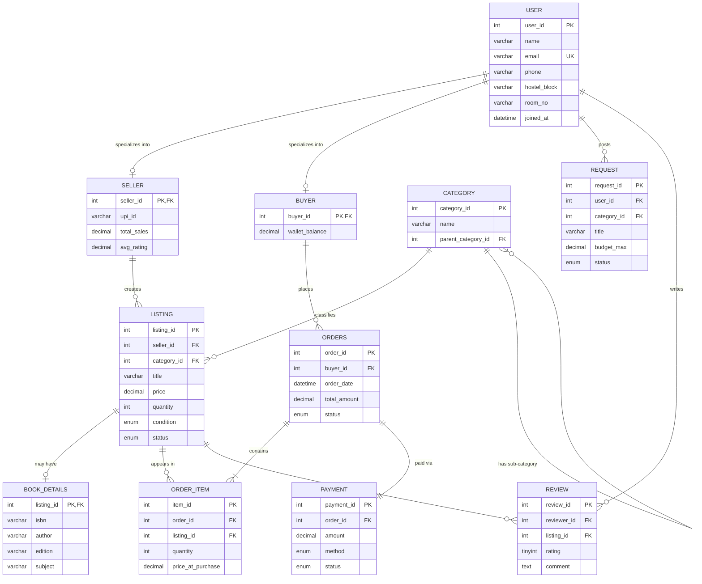

# 🔄 CampusSwap — Student Marketplace

> A comprehensive DBMS course project: a campus marketplace where students can buy and sell used textbooks, electronics, sports gear, and more.


---

## 📋 Problem Statement

Students in hostels frequently need to buy/sell used items — textbooks at semester start, sports equipment, electronics, furniture at graduation. Existing solutions (WhatsApp groups, notice boards) are unorganized, untrustworthy, and have no pricing transparency.

**CampusSwap** solves this by providing:
- A structured marketplace with categories and sub-categories
- Verified student sellers with ratings and reviews
- Price tracking and audit trails
- "Wanted" request board for items not yet listed
- Transaction safety through ACID-compliant order processing

---

## 🏗️ Project Architecture

```
campusswap/
├── sql/
│   ├── schema.sql               ← Stage 2: Tables, FKs, CHECKs, ENUMs
│   ├── seed.sql                 ← Stage 3: 100 users, 500 listings, etc.
│   ├── queries.sql              ← Stage 4: 10 queries, views, relational algebra
│   ├── normalization.sql        ← Stage 5: 1NF→2NF→3NF→BCNF decomposition
│   ├── procedures_triggers.sql  ← Stage 6: ACID procedures, triggers, cursors
│   └── indexes_concurrency.sql  ← Stage 7: B+ tree indexes, concurrency control
├── scripts/
│   └── generate_seed.py         ← Python script to generate seed.sql with Faker
├── frontend/
│   ├── index.html               ← Marketplace UI with "How it Works" button
│   ├── styles.css               ← Glassmorphic dark theme
│   └── app.js                   ← Listings, search, SQL showcase modal
├── docs/
│   └── er-design.md             ← ER diagram, mapping, viva Q&A
└── README.md                    ← You are here
```

---

## 🗺️ ER Diagram



**Specialization**: USER → SELLER/BUYER is **overlapping** (can be both) and **partial** (can be neither).

---

## 🗄️ Schema Summary

| Table | PK | Notable Constraints |
|-------|-----|---------------------|
| `USER` | user_id (AUTO_INCREMENT) | email UNIQUE |
| `SELLER` | seller_id (FK → USER) | ON DELETE CASCADE |
| `BUYER` | buyer_id (FK → USER) | ON DELETE CASCADE |
| `CATEGORY` | category_id | Self-ref FK (parent_category_id) |
| `LISTING` | listing_id | CHECK price > 0, ENUM status/condition |
| `BOOK_DETAILS` | listing_id (FK → LISTING) | ISBN, author, edition |
| `ORDERS` | order_id | CHECK total_amount >= 0 |
| `ORDER_ITEM` | item_id | CHECK quantity > 0, price > 0 |
| `PAYMENT` | payment_id | ENUM method (UPI/CASH/WALLET) |
| `REQUEST` | request_id | CHECK budget_max > 0 OR NULL |
| `REVIEW` | review_id | CHECK rating BETWEEN 1 AND 5, UNIQUE(reviewer, listing) |
| `PRICE_AUDIT` | audit_id | Filled by trigger, not application |

---

## 🚀 How to Run

### Prerequisites
- **MySQL 8.0+** installed
- **Python 3.8+** with `pip install faker`
- A web browser (for the frontend)

### Step-by-Step

```bash
# 1. Clone the repository
git clone https://github.com/YOUR_USERNAME/campusswap-dbms.git
cd campusswap-dbms

# 2. Create the database and tables
mysql -u root -p < sql/schema.sql

# 3. Generate seed data
pip install faker
cd scripts
python generate_seed.py
cd ..

# 4. Load seed data into MySQL
mysql -u root -p < sql/seed.sql

# 5. Run queries, procedures, triggers
mysql -u root -p campusswap < sql/queries.sql
mysql -u root -p campusswap < sql/procedures_triggers.sql
mysql -u root -p campusswap < sql/indexes_concurrency.sql

# 6. Open the frontend
# Just double-click frontend/index.html in your browser
# Click "How it Works" to see all the SQL behind the UI!
```

---

## 📊 Sample Query Outputs

### Top 5 Sellers by Revenue
```
+------------------+---------------+
| seller_name      | total_revenue |
+------------------+---------------+
| Arjun Sharma     |     15420.00  |
| Priya Mehta      |     12350.00  |
| Rohit Kumar      |      9800.00  |
| Sneha Reddy      |      8650.00  |
| Vikram Desai     |      7200.00  |
+------------------+---------------+
```

### Categories With 10+ Listings
```
+--------------------+---------------+
| category_name      | listing_count |
+--------------------+---------------+
| Engineering Books  |            85 |
| Electronics        |            62 |
| Fiction            |            45 |
+--------------------+---------------+
```

### EXPLAIN Before/After Indexing
```
-- BEFORE: type=ALL, rows=5000 (full table scan!)
-- AFTER:  type=range, rows=47  (B+ tree index lookup)
```

---

## 📝 Unit-wise Coverage

| Unit | Concepts Covered | File |
|------|-----------------|------|
| **Unit I** | ER model, specialization, mapping rules | `docs/er-design.md` |
| **Unit II** | Queries, JOINs, subqueries, GROUP BY, HAVING, SET operators, views, relational algebra | `sql/queries.sql` |
| **Unit III** | Normalization (1NF → BCNF), FDs, closure, anomalies | `sql/normalization.sql` |
| **Unit IV** | Stored procedures, triggers, cursors, ACID transactions | `sql/procedures_triggers.sql` |
| **Unit V** | B+ tree indexes, EXPLAIN, concurrency (SELECT FOR UPDATE), deadlocks | `sql/indexes_concurrency.sql` |

---

## ❓ Viva Questions & Answers

### ER Design
**Q: Why is USER→SELLER/BUYER overlapping and partial?**
> A user can be BOTH a seller and buyer (overlapping). Not every user has to be either — new users just browse (partial).

**Q: Why use a self-referencing FK on CATEGORY?**
> It creates a tree structure: Books → Engineering Books → CSE. Any depth is possible with the same table design.

**Q: Why is ORDER_ITEM needed?**
> One order can have multiple items (1:M). Without it, we'd need repeating groups, violating 1NF.

### Schema
**Q: Why DECIMAL instead of FLOAT for prices?**
> FLOAT has rounding errors (0.1 + 0.2 ≠ 0.3). DECIMAL stores exact values — critical for financial data.

**Q: Why ON DELETE CASCADE on SELLER but RESTRICT on CATEGORY?**
> Deleting a user should clean up their seller profile (CASCADE). Deleting a category with listings would orphan data — RESTRICT forces re-categorization first.

**Q: Why store price_at_purchase in ORDER_ITEM?**
> Seller might change the listing price later. The order records the actual price paid — it's a historical fact.

**Q: Why MySQL instead of Oracle?**
> MySQL is free, portable, and supports the same features (FK, triggers, procedures, transactions). The SQL is 95% identical. Oracle uses SEQUENCE instead of AUTO_INCREMENT, VARCHAR2 instead of VARCHAR, and MINUS instead of EXCEPT.

### Queries
**Q: Difference between WHERE and HAVING?**
> WHERE filters individual rows BEFORE grouping. HAVING filters groups AFTER aggregation. You can't use aggregate functions (COUNT, SUM) in WHERE.

**Q: What is a correlated subquery?**
> A subquery that references a column from the outer query. It re-executes for every row in the outer table. Regular subqueries run only once.

**Q: How does LEFT JOIN find "missing" records?**
> LEFT JOIN keeps ALL rows from the left table. If there's no match on the right, those columns are NULL. Filtering `WHERE right.id IS NULL` gives rows with no match.

**Q: Why UNION instead of UNION ALL?**
> UNION removes duplicates. UNION ALL keeps them. Use UNION ALL when you know there are no duplicates (it's faster).

### Normalization
**Q: What is a functional dependency?**
> X → Y means "if you know X, you can uniquely determine Y." Example: email → name (knowing email tells you the name).

**Q: What are the normal forms?**
> 1NF: atomic values, no repeating groups. 2NF: no partial dependencies (all non-key attributes depend on the FULL key). 3NF: no transitive dependencies. BCNF: every determinant is a candidate key.

**Q: What is attribute closure?**
> Start with a set of attributes, repeatedly apply FDs to find all attributes that can be determined. If the closure equals all attributes, it's a superkey.

### Transactions & Triggers
**Q: What does ACID mean?**
> Atomicity: all-or-nothing. Consistency: DB stays valid. Isolation: concurrent transactions don't interfere. Durability: committed data survives crashes.

**Q: Why use a trigger instead of application code?**
> Triggers enforce rules at the database level — can't be bypassed by buggy application code. Example: auto-marking listing as SOLD when quantity reaches 0.

**Q: What is a cursor?**
> An iterator that processes rows one by one. Useful when row-by-row logic is needed. In practice, a single UPDATE is faster, but cursors demonstrate the concept for your syllabus.

### Indexing & Concurrency
**Q: What is a B+ tree index?**
> A balanced tree where internal nodes guide the search and leaf nodes (linked in order) store pointers to rows. All leaf nodes are at the same depth, guaranteeing O(log n) lookups.

**Q: What is the leftmost prefix rule?**
> A composite index on (A, B) helps queries filtering on A, or A+B, but NOT B alone. Like a phone book sorted by (last_name, first_name).

**Q: What does SELECT ... FOR UPDATE do?**
> Locks the selected rows until COMMIT/ROLLBACK. Other transactions trying to read the same rows with FOR UPDATE will WAIT. Prevents race conditions like two buyers purchasing the last copy.

**Q: What is a deadlock?**
> Two transactions each hold a lock and wait for the other's lock. Neither can proceed. MySQL detects this and kills one transaction.

---

## 👥 Team

| Name | Contribution |
|------|-------------|
| — | Schema, ER Design |
| — | Queries, Views |
| — | Normalization |
| — | Procedures, Triggers |
| — | Frontend, Report |

---

## 📄 License

Academic project for DBMS course (B.Tech CSE). Not for commercial use.

---

<p align="center">
  Built with MySQL, Python, and ❤️ by B.Tech CSE students<br>
  <em>Click "How it Works" in the frontend to see the SQL behind every feature!</em>
</p>
