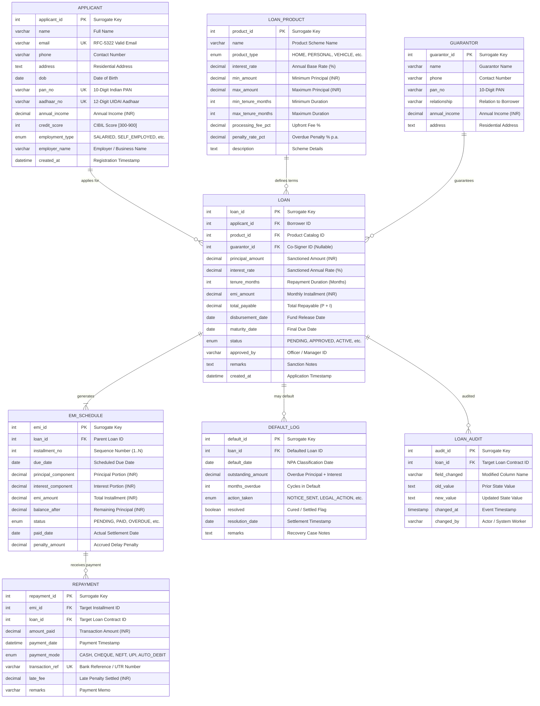

# Bank Loan Management System — ER Design & Relational Mapping

> [!NOTE]
> **Project Title**: Bank Loan Management System: EMI Processing, Repayment Tracking, and Risk Assessment  
> **Course**: Database Management Systems (B.Tech CSE)  
> **Target RDBMS**: MySQL 8.0+ (InnoDB Engine)  
> **Document Purpose**: Complete architectural specification of the Entity-Relationship (ER) model, Relational Schema mapping, Normalization analysis (1NF through BCNF), Amortization mathematics, and Viva Examination defense.

---

## 1. System Overview & Domain Context

The **Bank Loan Management System (BLMS)** is an enterprise financial database designed to model the complete lifecycle of retail and commercial credit products within an Indian banking framework (aligned with RBI regulatory standards and SBI-style credit workflows).

The system manages:
1. **Applicant KYC & Underwriting**: Registration of retail borrowers with Indian national tax and identity credentials (PAN, Aadhaar), employment classification, income verification, and bureau credit scores (CIBIL 300–900).
2. **Loan Product Catalog**: Configurable credit products across key banking portfolios (*Home, Personal, Vehicle, Education, Business, Gold, Agriculture*) with strict tenure, borrowing limit, processing fee, and penalty boundaries.
3. **Collateral & Guarantor Assessment**: Co-signer and guarantor liability management for credit risk mitigation.
4. **Loan Contract Execution**: Sanctioning, approval hierarchies, interest assignment, total liability calculation, and disbursement tracking.
5. **Amortization & EMI Schedule Engine**: Accurate generation of monthly installments broken down into reducing balance principal components, interest components, and declining outstanding balances.
6. **Repayment & Settlement Ledger**: Double-entry financial audit trail of borrower repayments via diverse banking channels (NEFT, UPI, Cheque, Auto-Debit, Cash) with late fee handling and transaction deduplication.
7. **Risk Assessment & Default Management (NPA Tracking)**: Automated classification of Non-Performing Assets (NPAs) exceeding 90-day overdue thresholds, tracking formal recovery actions (*Notice Sent, Legal Action, Recovery Agent, Write-Off, Restructured*).
8. **Forensic Loan Audit Trail**: Change data capture (CDC) logging of loan contract status transitions, interest renegotiations, and administrative overrides.

---

## 2. Mermaid Entity-Relationship Diagram (ERD)

The following diagram represents all 8 entities, their structural attributes, candidate/primary/foreign keys, and exact relationship cardinalities using Crow's Foot notation.

---

## 3. Data Dictionary & Entity Specifications

Below is the exhaustive specification of all 8 relations, detailing primary keys, foreign keys, candidate keys, physical data types, nullability, default values, and domain check constraints.

### 3.1 `APPLICANT`
*Primary Entity representing credit applicants / borrowers.*

| Column Name | SQL Data Type | Key / Constraint | Default | Description & Business Validation |
|---|---|---|---|---|
| `applicant_id` | `INT` | **PK**, AUTO_INCREMENT | *None* | Surrogate primary key for index efficiency. |
| `name` | `VARCHAR(100)` | `NOT NULL` | *None* | Legal name matching official KYC documents. |
| `email` | `VARCHAR(150)` | `NOT NULL`, **UK** (`uq_applicant_email`) | *None* | Primary communication handle; duplicate emails disallowed. |
| `phone` | `VARCHAR(15)` | `NOT NULL` | *None* | Contact number for OTP and automated billing notices. |
| `address` | `TEXT` | `NOT NULL` | *None* | Permanent residential address for verification. |
| `dob` | `DATE` | `NOT NULL` | *None* | Date of birth (used for legal age verification $\ge 18$). |
| `pan_no` | `VARCHAR(10)` | `NOT NULL`, **UK** (`uq_applicant_pan`), `CHECK` | *None* | Indian Income Tax PAN. Length must equal 10 chars. |
| `aadhaar_no` | `VARCHAR(12)` | `NOT NULL`, **UK** (`uq_applicant_aadhaar`), `CHECK` | *None* | Indian 12-digit UIDAI identity number. Length = 12 chars. |
| `annual_income` | `DECIMAL(12,2)` | `NOT NULL`, `CHECK` ($\ge 0$) | *None* | Certified gross annual income in INR. |
| `credit_score` | `INT` | `NOT NULL`, `CHECK` ($300 \le x \le 900$) | *None* | CIBIL/Experian credit score; values outside 300–900 rejected. |
| `employment_type`| `ENUM` | `NOT NULL` | *None* | Allowed: `'SALARIED'`, `'SELF_EMPLOYED'`, `'BUSINESS'`, `'RETIRED'`, `'STUDENT'`. |
| `employer_name` | `VARCHAR(150)` | `DEFAULT NULL` | `NULL` | Organization / firm name for income verification. |
| `created_at` | `DATETIME` | `NOT NULL` | `CURRENT_TIMESTAMP`| System registration timestamp. |

---

### 3.2 `LOAN_PRODUCT`
*Master catalog of standardized credit schemes offered by the bank.*

| Column Name | SQL Data Type | Key / Constraint | Default | Description & Business Validation |
|---|---|---|---|---|
| `product_id` | `INT` | **PK**, AUTO_INCREMENT | *None* | Unique scheme identifier. |
| `name` | `VARCHAR(100)` | `NOT NULL` | *None* | Commercial scheme name (e.g., "SBI Regular Home Loan"). |
| `product_type` | `ENUM` | `NOT NULL` | *None* | Allowed: `'HOME'`, `'PERSONAL'`, `'VEHICLE'`, `'EDUCATION'`, `'BUSINESS'`, `'GOLD'`, `'AGRICULTURE'`. |
| `interest_rate` | `DECIMAL(5,2)` | `NOT NULL`, `CHECK` ($> 0$) | *None* | Base annual percentage rate (APR) (e.g., 8.50%). |
| `min_amount` | `DECIMAL(12,2)` | `NOT NULL`, `CHECK` ($> 0$) | *None* | Minimum sanctionable principal amount. |
| `max_amount` | `DECIMAL(12,2)` | `NOT NULL`, `CHECK` ($\ge \text{min\_amount}$) | *None* | Maximum sanctionable principal amount. |
| `min_tenure_months`| `INT` | `NOT NULL`, `CHECK` ($> 0$) | *None* | Minimum repayment term in months. |
| `max_tenure_months`| `INT` | `NOT NULL`, `CHECK` ($\ge \text{min\_tenure}$) | *None* | Maximum repayment term in months. |
| `processing_fee_pct`| `DECIMAL(4,2)`| `NOT NULL`, `CHECK` ($0 \le x \le 100$) | `0.00` | Upfront administrative deduction fee percentage. |
| `penalty_rate_pct` | `DECIMAL(4,2)`| `NOT NULL`, `CHECK` ($0 \le x \le 100$) | `0.00` | Annualized penal interest rate assessed on overdue EMIs. |
| `description` | `TEXT` | `DEFAULT NULL` | `NULL` | Detailed terms, collateral requirements, and caveats. |

---

### 3.3 `GUARANTOR`
*Co-signers and financial guarantors providing collateral security.*

| Column Name | SQL Data Type | Key / Constraint | Default | Description & Business Validation |
|---|---|---|---|---|
| `guarantor_id` | `INT` | **PK**, AUTO_INCREMENT | *None* | Unique surrogate identifier. |
| `name` | `VARCHAR(100)` | `NOT NULL` | *None* | Legal name of co-signer / guarantor. |
| `phone` | `VARCHAR(15)` | `NOT NULL` | *None* | Contact phone number. |
| `pan_no` | `VARCHAR(10)` | `NOT NULL`, `CHECK` (Length = 10) | *None* | Tax PAN of guarantor for financial recovery checks. |
| `relationship` | `VARCHAR(50)` | `NOT NULL` | *None* | Familial or corporate relationship to borrower. |
| `annual_income` | `DECIMAL(12,2)` | `NOT NULL`, `CHECK` ($\ge 0$) | *None* | Verified annual income in INR. |
| `address` | `TEXT` | `NOT NULL` | *None* | Verified permanent residential address. |

---

### 3.4 `LOAN`
*Central operational entity capturing sanctioned credit contracts.*

| Column Name | SQL Data Type | Key / Constraint | Default | Description & Business Validation |
|---|---|---|---|---|
| `loan_id` | `INT` | **PK**, AUTO_INCREMENT | *None* | Unique loan account number / contract identifier. |
| `applicant_id` | `INT` | `NOT NULL`, **FK** $\to$ `APPLICANT` | *None* | `ON DELETE RESTRICT ON UPDATE CASCADE`. Borrower link. |
| `product_id` | `INT` | `NOT NULL`, **FK** $\to$ `LOAN_PRODUCT` | *None* | `ON DELETE RESTRICT ON UPDATE CASCADE`. Product link. |
| `guarantor_id` | `INT` | `DEFAULT NULL`, **FK** $\to$ `GUARANTOR` | `NULL` | `ON DELETE SET NULL ON UPDATE CASCADE`. Optional co-signer. |
| `principal_amount`| `DECIMAL(12,2)`| `NOT NULL`, `CHECK` ($> 0$) | *None* | Net sanctioned loan borrowing amount in INR. |
| `interest_rate` | `DECIMAL(5,2)` | `NOT NULL`, `CHECK` ($> 0$) | *None* | Contractual annual interest rate locked at sanction. |
| `tenure_months` | `INT` | `NOT NULL`, `CHECK` ($> 0$) | *None* | Agreed repayment tenure in months. |
| `emi_amount` | `DECIMAL(10,2)` | `NOT NULL`, `CHECK` ($> 0$) | *None* | Equated Monthly Installment calculated via reducing balance. |
| `total_payable` | `DECIMAL(12,2)` | `NOT NULL`, `CHECK` ($\ge \text{principal}$) | *None* | Total anticipated cash outflow ($P + \text{Total Interest}$). |
| `disbursement_date`| `DATE` | `DEFAULT NULL` | `NULL` | Date funds are released to borrower's account. |
| `maturity_date` | `DATE` | `DEFAULT NULL` | `NULL` | Contractual final installment date ($T_0 + n \text{ months}$). |
| `status` | `ENUM` | `NOT NULL` | `'PENDING'` | Allowed: `'PENDING'`, `'APPROVED'`, `'ACTIVE'`, `'CLOSED'`, `'DEFAULTED'`, `'REJECTED'`. |
| `approved_by` | `VARCHAR(100)` | `DEFAULT NULL` | `NULL` | Branch manager / credit officer authorization ID. |
| `remarks` | `TEXT` | `DEFAULT NULL` | `NULL` | Underwriter observations, covenants, or rejection reasons. |
| `created_at` | `DATETIME` | `NOT NULL` | `CURRENT_TIMESTAMP`| Application entry creation timestamp. |

---

### 3.5 `EMI_SCHEDULE`
*Discrete monthly amortization schedule generated upon loan sanctioning.*

| Column Name | SQL Data Type | Key / Constraint | Default | Description & Business Validation |
|---|---|---|---|---|
| `emi_id` | `INT` | **PK**, AUTO_INCREMENT | *None* | Unique installment primary key. |
| `loan_id` | `INT` | `NOT NULL`, **FK** $\to$ `LOAN` | *None* | `ON DELETE CASCADE ON UPDATE CASCADE`. Parent loan contract. |
| `installment_no`| `INT` | `NOT NULL`, **UK** (`uq_loan_installment`) | *None* | Sequence number ($1 \le k \le n$). Compound unique with `loan_id`. |
| `due_date` | `DATE` | `NOT NULL` | *None* | Standard calendar due date for installment $k$. |
| `principal_component`| `DECIMAL(10,2)`| `NOT NULL`, `CHECK` ($\ge 0$) | *None* | Fraction of EMI allocated to loan principal reduction. |
| `interest_component` | `DECIMAL(10,2)`| `NOT NULL`, `CHECK` ($\ge 0$) | *None* | Fraction of EMI allocated to interest accrued on balance. |
| `emi_amount` | `DECIMAL(10,2)` | `NOT NULL`, `CHECK` ($> 0$) | *None* | Contractual installment total ($P_{\text{comp}} + I_{\text{comp}}$). |
| `balance_after` | `DECIMAL(12,2)` | `NOT NULL`, `CHECK` ($\ge 0$) | *None* | Outstanding principal remaining after installment $k$. |
| `status` | `ENUM` | `NOT NULL` | `'PENDING'` | Allowed: `'PENDING'`, `'PAID'`, `'OVERDUE'`, `'PARTIALLY_PAID'`. |
| `paid_date` | `DATE` | `DEFAULT NULL` | `NULL` | Date on which the installment was fully cleared. |
| `penalty_amount`| `DECIMAL(10,2)`| `NOT NULL`, `CHECK` ($\ge 0$) | `0.00` | Delay fee levied due to past-due delinquency. |

---

### 3.6 `REPAYMENT`
*Monetary cash-inflow ledger recording payments against loan installments.*

| Column Name | SQL Data Type | Key / Constraint | Default | Description & Business Validation |
|---|---|---|---|---|
| `repayment_id` | `INT` | **PK**, AUTO_INCREMENT | *None* | Transaction ledger sequence key. |
| `emi_id` | `INT` | `NOT NULL`, **FK** $\to$ `EMI_SCHEDULE` | *None* | `ON DELETE RESTRICT ON UPDATE CASCADE`. Installment link. |
| `loan_id` | `INT` | `NOT NULL`, **FK** $\to$ `LOAN` | *None* | `ON DELETE RESTRICT ON UPDATE CASCADE`. Loan link. |
| `amount_paid` | `DECIMAL(10,2)` | `NOT NULL`, `CHECK` ($> 0$) | *None* | Monetary cash amount credited in INR. |
| `payment_date` | `DATETIME` | `NOT NULL` | `CURRENT_TIMESTAMP`| Actual clearing timestamp of financial transaction. |
| `payment_mode` | `ENUM` | `NOT NULL` | *None* | Allowed: `'CASH'`, `'CHEQUE'`, `'NEFT'`, `'UPI'`, `'AUTO_DEBIT'`. |
| `transaction_ref`| `VARCHAR(100)`| `NOT NULL`, **UK** (`uq_repayment_txn`) | *None* | Bank UTR / Gateway reference (strictly deduplicated). |
| `late_fee` | `DECIMAL(10,2)` | `NOT NULL`, `CHECK` ($\ge 0$) | `0.00` | Portion of payment allocated toward accrued penalties. |
| `remarks` | `VARCHAR(255)` | `DEFAULT NULL` | `NULL` | Depositor remarks, cheque clearance notes. |

---

### 3.7 `DEFAULT_LOG`
*Delinquency escalation and Non-Performing Asset (NPA) management log.*

| Column Name | SQL Data Type | Key / Constraint | Default | Description & Business Validation |
|---|---|---|---|---|
| `default_id` | `INT` | **PK**, AUTO_INCREMENT | *None* | Escalation event log identifier. |
| `loan_id` | `INT` | `NOT NULL`, **FK** $\to$ `LOAN` | *None* | `ON DELETE RESTRICT ON UPDATE CASCADE`. Defaulted account. |
| `default_date` | `DATE` | `NOT NULL` | *None* | Formal date of default / NPA classification (e.g. Day 91). |
| `outstanding_amount`| `DECIMAL(12,2)`| `NOT NULL`, `CHECK` ($\ge 0$) | *None* | Total overdue principal + penal interest at time of action. |
| `months_overdue`| `INT` | `NOT NULL`, `CHECK` ($\ge 1$) | *None* | Consecutive months unpaid ($> 3$ triggers NPA status). |
| `action_taken` | `ENUM` | `NOT NULL` | `'NOTICE_SENT'`| Allowed: `'NOTICE_SENT'`, `'LEGAL_ACTION'`, `'RECOVERY_AGENT'`, `'WRITE_OFF'`, `'RESTRUCTURED'`. |
| `resolved` | `BOOLEAN` | `NOT NULL` | `FALSE` | Recovery status indicator (`TRUE` once settled/cured). |
| `resolution_date`| `DATE` | `DEFAULT NULL` | `NULL` | Date when settlement or loan restructuring finalized. |
| `remarks` | `TEXT` | `DEFAULT NULL` | `NULL` | Recovery officer notes, SARFAESI notice IDs. |

---

### 3.8 `LOAN_AUDIT`
*Change Data Capture (CDC) audit trail capturing forensic loan state history.*

| Column Name | SQL Data Type | Key / Constraint | Default | Description & Business Validation |
|---|---|---|---|---|
| `audit_id` | `INT` | **PK**, AUTO_INCREMENT | *None* | Immutable audit entry identifier. |
| `loan_id` | `INT` | `NOT NULL`, **FK** $\to$ `LOAN` | *None* | `ON DELETE CASCADE ON UPDATE CASCADE`. Subject loan record. |
| `field_changed` | `VARCHAR(50)` | `NOT NULL` | *None* | Column modified (e.g., `'status'`, `'interest_rate'`). |
| `old_value` | `TEXT` | `DEFAULT NULL` | `NULL` | Value prior to update. |
| `new_value` | `TEXT` | `DEFAULT NULL` | `NULL` | Value post update. |
| `changed_at` | `TIMESTAMP` | `NOT NULL` | `CURRENT_TIMESTAMP`| Forensic audit timestamp. |
| `changed_by` | `VARCHAR(100)` | `NOT NULL` | `'SYSTEM'` | User ID, teller username, or background process name. |

---

## 4. Relationship Cardinalities & Participation Analysis

The relational schema strictly maps real-world banking relationships with clear structural cardinality constraints ($1:1$, $1:M$, $M:N$) and participation rules (total vs. partial).

| Parent Entity | Child Entity | Cardinality | Participation (Parent $\to$ Child) | Participation (Child $\to$ Parent) | Business Rationale & Integrity Enactment |
|---|---|---|---|---|---|
| **APPLICANT** | **LOAN** | $1 : M$ | **Partial** ($0..*$) | **Total** ($1..1$) | An applicant may register without taking a loan or may have their application rejected. Conversely, every sanctioned loan contract MUST link to exactly one valid applicant (`applicant_id NOT NULL`). |
| **LOAN_PRODUCT** | **LOAN** | $1 : M$ | **Partial** ($0..*$) | **Total** ($1..1$) | A loan scheme in the product catalog can exist without active borrowers. However, every loan contract MUST strictly belong to an authorized bank product scheme (`product_id NOT NULL`). |
| **GUARANTOR** | **LOAN** | $1 : M$ | **Partial** ($0..*$) | **Partial** ($0..1$) | A guarantor may be registered in the system before being bound to a loan, and can guarantee multiple loans. Crucially, collateral/guarantors are optional (`guarantor_id NULL`) for clean retail loans. |
| **LOAN** | **EMI_SCHEDULE**| $1 : M$ | **Total** ($1..*$) | **Total** ($1..1$) | An active loan contract generates exactly $n$ installments ($1 \le k \le n$). An installment record cannot exist in isolation without its parent loan contract. |
| **EMI_SCHEDULE**| **REPAYMENT** | $1 : M$ | **Partial** ($0..*$) | **Total** ($1..1$) | An upcoming or unpaid EMI installment has 0 repayment records. Multiple partial repayments can be applied to the same installment. Every repayment must be mapped to an installment. |
| **LOAN** | **DEFAULT_LOG** | $1 : M$ | **Partial** ($0..*$) | **Total** ($1..1$) | Performing loans never have records in `DEFAULT_LOG`. Delinquent loans generate escalation log records. Every default log record must reference a valid loan contract. |
| **LOAN** | **LOAN_AUDIT** | $1 : M$ | **Partial** ($0..*$) | **Total** ($1..1$) | Newly inserted loans may have no audit history prior to state transitions. Each audit log row strictly tracks modifications on an existing loan contract. |

---

## 5. ER-to-Relational Mapping Rules Applied

The conceptual ER model was mapped to physical MySQL 8.0 relational tables following formal database conversion algorithms:

### Rule 1: Mapping of Strong (Regular) Entities
- **Concepts**: `APPLICANT`, `LOAN_PRODUCT`, `GUARANTOR`.
- **Transformation**: Each strong entity is mapped directly to an independent relational table.
- **Attributes**: Simple, single-valued attributes map directly to columns.
- **Primary Key**: A surrogate integer column (`*_id AUTO_INCREMENT`) is assigned as the primary key. Business natural keys (`pan_no`, `aadhaar_no`, `email`) are enforced via `UNIQUE` constraints.

### Rule 2: Mapping of 1:M Binary Relationships with Mandatory Participation on the "Many" Side
- **Concepts**: `APPLICANT (1) → LOAN (M)`, `LOAN_PRODUCT (1) → LOAN (M)`.
- **Transformation**: The Primary Key of the "One" side entity is placed as a Foreign Key attribute inside the relation representing the "Many" side (`applicant_id` and `product_id` inside `LOAN`).
- **Integrity**: Because participation on the "Many" side is total, both FK columns are declared `NOT NULL`.
- **Referential Action**: Both foreign keys specify `ON DELETE RESTRICT` to prevent orphaned contracts and ensure audit retention.

### Rule 3: Mapping of 1:M Relationships with Optional Participation on the "Many" Side
- **Concepts**: `GUARANTOR (1) → LOAN (M)`.
- **Transformation**: The Primary Key of `GUARANTOR` is placed inside `LOAN` as `guarantor_id`.
- **Nullability**: Because a personal/gold loan does not mandate a third-party guarantor, `guarantor_id` is defined as `NULL` allowed.
- **Referential Action**: Configured with `ON DELETE SET NULL` so that if a guarantor record is severed or purged, the underlying active loan obligation is preserved.

### Rule 4: Mapping of Dependent Entities with Composite Uniqueness
- **Concepts**: `LOAN (1) → EMI_SCHEDULE (M)`.
- **Transformation**: `EMI_SCHEDULE` includes `loan_id` as a foreign key pointing to `LOAN(loan_id)`.
- **Identification & Uniqueness**: While an independent surrogate key `emi_id` is used as the physical PK for storage and joining efficiency, a composite candidate key constraint `UNIQUE (loan_id, installment_no)` is enforced to preserve the weak/dependent semantic identity of installment sequences.
- **Referential Action**: Configured with `ON DELETE CASCADE` because if an unbooked/draft loan application is purged, its prospective installment schedule must be removed atomically.

### Rule 5: Dual FK Placement for High-Frequency Transaction Logs
- **Concepts**: `REPAYMENT` referencing both `EMI_SCHEDULE` and `LOAN`.
- **Transformation**: `repayment_id` is the primary key. It holds `emi_id` (identifying the specific installment being settled) and `loan_id` (identifying the overall credit contract).
- **Justification**: Although `loan_id` is transitively accessible via `EMI_SCHEDULE.loan_id`, storing `loan_id` directly in `REPAYMENT` is an intentional, controlled design choice that facilitates high-performance direct ledger queries and statement generation without multi-table joins, while maintaining referential integrity via dual foreign keys.

### Rule 6: Mapping of Domain Constraints & Business Assertions
- Table-level and column-level `CHECK` constraints enforce financial sanity rules directly inside the storage engine, guaranteeing data integrity independent of application-level bugs:
  - Non-negative balances and incomes: `CHECK (annual_income >= 0)`, `CHECK (balance_after >= 0)`.
  - Boundary ranges: `CHECK (credit_score BETWEEN 300 AND 900)`.
  - Interval consistency: `CHECK (max_amount >= min_amount)`, `CHECK (max_tenure_months >= min_tenure_months)`.
  - Financial sanity: `CHECK (total_payable >= principal_amount)`.

---

## 6. Normalization Analysis (1NF to BCNF)

To ensure zero unwanted data redundancy, zero update anomalies, and zero deletion anomalies, all tables have been designed to comply with **Boyce-Codd Normal Form (BCNF)**.

### 6.1 First Normal Form (1NF)
- **Criterion**: Every attribute must be atomic (indivisible values). No repeating groups, arrays, or nested records.
- **Compliance**:
  - All attributes store single scalar values (`VARCHAR`, `DECIMAL`, `INT`, `DATE`).
  - No comma-separated strings (e.g., applicant addresses are scalar texts, installments are discrete rows in `EMI_SCHEDULE` rather than an array of amounts in `LOAN`).
  - Each table possesses an explicit Primary Key.

### 6.2 Second Normal Form (2NF)
- **Criterion**: Table must be in 1NF, and every non-prime attribute must be **fully functionally dependent** on the whole primary key (no partial functional dependencies on candidate keys).
- **Compliance**:
  - In tables with single-attribute primary keys (`APPLICANT`, `LOAN_PRODUCT`, `GUARANTOR`, `LOAN`, `REPAYMENT`, `DEFAULT_LOG`, `LOAN_AUDIT`), partial dependency is mathematically impossible because all PKs are single-attribute surrogate keys.
  - In `EMI_SCHEDULE`, the physical PK is `emi_id`. For the composite candidate key `(loan_id, installment_no)`:
    $$\{loan\_id, installment\_no\} \to \{due\_date, principal\_component, interest\_component, emi\_amount, balance\_after, status\}$$
    None of these financial attributes depend solely on `loan_id` (which only specifies the loan) or `installment_no` (which only specifies installment sequence 1, 2, 3 across all loans). Both are strictly required. Hence, 2NF is satisfied.

### 6.3 Third Normal Form (3NF)
- **Criterion**: Table must be in 2NF, and no non-prime attribute may be **transitively dependent** on the primary key (no $X \to Y$ and $Y \to Z$ where $X$ is a superkey and $Y$ is not a superkey).
- **Compliance**:
  - In `APPLICANT`: `applicant_id → pan_no → annual_income`? While `pan_no` is unique, it is a candidate key. In 3NF, dependencies on candidate keys are permitted.
  - In `LOAN`: Product attributes (`name`, `description`, base `min_amount`, `max_amount`) are NOT duplicated inside `LOAN`. Only `product_id` is stored. Therefore, no transitive dependency on product attributes exists.
  - In `EMI_SCHEDULE`: Installment figures are computed values recorded as historical states; they do not depend on attributes of another non-key column.

### 6.4 Boyce-Codd Normal Form (BCNF)
- **Criterion**: A relation $R$ is in BCNF if and only if for every non-trivial functional dependency $X \to Y$, the determinant $X$ is a **superkey**.
- **Compliance**:
  - In `APPLICANT`: The only non-trivial functional dependencies are:
    - `applicant_id` $\to$ all attributes (`applicant_id` is a superkey).
    - `email` $\to$ all attributes (`email` is an alternate superkey).
    - `pan_no` $\to$ all attributes (`pan_no` is an alternate superkey).
    - `aadhaar_no` $\to$ all attributes (`aadhaar_no` is an alternate superkey).
    In all cases, the determinant is a candidate/superkey.
  - In `REPAYMENT`: Determinants are `repayment_id` and `transaction_ref`. Both are candidate superkeys.
  - Hence, all tables satisfy BCNF.

---

## 7. Mathematics of EMI & Reducing Balance Amortization

An Equated Monthly Installment (EMI) is a fixed payment amount made by a borrower to a bank on a specified date of each calendar month. The BLMS database is built on the mathematically rigorous **Reducing Balance Amortization Formula**.

### 7.1 The Standard EMI Formula

Given:
- $P$ = Sanctioned Principal Loan Amount (`principal_amount` in `LOAN`)
- $R_{\text{annual}}$ = Annual Interest Rate in % (`interest_rate` in `LOAN`)
- $n$ = Total repayment tenure in months (`tenure_months` in `LOAN`)
- $r$ = Monthly periodic interest rate = $\frac{R_{\text{annual}}}{12 \times 100}$

The equated monthly installment $E$ is calculated as:

$$E = P \times r \times \frac{(1 + r)^n}{(1 + r)^n - 1}$$

### 7.2 Installment-by-Installment Component Breakdown

For each installment $k$ where $k \in \{1, 2, \dots, n\}$:

1. **Opening Balance for Month $k$ ($B_{k-1}$)**:
   - For $k = 1$: $B_0 = P$
   - For $k > 1$: Outstanding balance remaining after installment $k-1$.

2. **Interest Component ($I_k$)**:
   The interest accrued on the remaining principal for the billing cycle:
   $$I_k = B_{k-1} \times r$$

3. **Principal Component ($P_k$)**:
   The balance of the installment that directly liquidates the principal:
   $$P_k = E - I_k$$

4. **Closing Balance after Installment $k$ ($B_k$)**:
   $$B_k = B_{k-1} - P_k$$
   *(Stored as `balance_after` in `EMI_SCHEDULE`)*

5. **Terminal Condition**:
   At final maturity $k = n$:
   $$B_n = 0.00$$

> [!TIP]
> **Amortization Dynamics for Viva**: In early installments ($k \ll n$), $B_{k-1}$ is large, so the **interest component constitutes the majority of the EMI**. As the principal reduces over time, $I_k$ monotonically declines while $P_k$ monotonically increases. The total installment $E = P_k + I_k$ remains constant throughout the tenure.

---

## 8. Viva Examination Defense Q&A

The following 12 questions and detailed answers prepare students to defend every technical and architectural decision made in this schema during their project viva.

---

### Q1: Why did you use surrogate keys (`applicant_id`, `loan_id`) instead of natural keys like `pan_no` or `aadhaar_no`?
> **Answer**:
> 1. **Index Performance & B-Tree Storage**: A 4-byte integer (`INT`) or 8-byte integer (`BIGINT`) surrogate key is vastly more compact than a 10-character (`VARCHAR(10)`) PAN or 12-character (`VARCHAR(12)`) Aadhaar string. Secondary indexes and foreign key references store the primary key; smaller keys reduce B-Tree page splits and maximize buffer pool cache hits.
> 2. **Immutability Principle**: Primary keys should never change. In reality, government documents can undergo legal corrections, data rectification, or re-issuance. Changing a natural primary key cascades expensive update locks across child tables.
> 3. **Privacy & Security**: Exposing sensitive identifiers like Aadhaar numbers in child foreign keys and API URLs introduces privacy risks.
> Natural keys are preserved and protected by enforcing `UNIQUE` constraints (`uq_applicant_pan`, `uq_applicant_aadhaar`).

---

### Q2: Why is `DECIMAL(12,2)` used for monetary values instead of `FLOAT` or `DOUBLE`?
> **Answer**:
> `FLOAT` and `DOUBLE` use binary floating-point representation (IEEE 754 standard). Binary systems cannot accurately represent decimal fractions like `0.10` or `0.05` without repeating fractions, causing cumulative rounding errors (e.g., `0.1 + 0.2 = 0.30000000000000004`). In financial systems, even a 1-paisa rounding discrepancy violates double-entry balancing rules and statutory audits.
> `DECIMAL(12,2)` is an **exact fixed-point numeric data type**. MySQL stores each digit in binary-coded decimal form, guaranteeing that all additions, deductions, interest accruals, and ledger balances balance to the exact cent/paisa.

---

### Q3: Explain the design rationale behind the differing referential actions on `LOAN` (`ON DELETE RESTRICT` for `APPLICANT` and `LOAN_PRODUCT`, but `ON DELETE SET NULL` for `GUARANTOR`).
> **Answer**:
> - **`ON DELETE RESTRICT` on `APPLICANT` & `LOAN_PRODUCT`**: A bank can never delete a customer account or a financial loan product if active or historical loan contracts are linked to them. Doing so would destroy the audit trail, orphan legal commitments, and violate RBI compliance. RESTRICT forces the database engine to block the deletion.
> - **`ON DELETE SET NULL` on `GUARANTOR`**: A guarantor is a secondary guarantor. If a guarantor is legally discharged, dies, or is replaced, the underlying borrower remains 100% obligated to pay the loan. Setting `guarantor_id` to `NULL` preserves the loan contract while accurately reflecting that no active guarantor is currently attached.

---

### Q4: Why does `EMI_SCHEDULE` use `ON DELETE CASCADE` from `LOAN`?
> **Answer**:
> `EMI_SCHEDULE` is an amortized breakdown derived directly from the terms of the loan contract. If an unbooked loan application is cancelled, rejected, or purged during application processing, its prospective installment schedule has no standalone existence or business meaning. `ON DELETE CASCADE` guarantees atomic cleanup, preventing orphan installment records. In contrast, for booked loans with payments, `REPAYMENT` enforces `ON DELETE RESTRICT`, which inherently protects both `EMI_SCHEDULE` and `LOAN` from deletion once real money has been received.

---

### Q5: Why is `UNIQUE(loan_id, installment_no)` defined on `EMI_SCHEDULE` when an `emi_id` Primary Key already exists?
> **Answer**:
> While `emi_id` uniquely identifies a row at the physical storage level, it does not prevent a logical duplicate such as having two "Installment #3" records for the same loan account `loan_id = 101`. The composite constraint `UNIQUE(loan_id, installment_no)` guarantees logical domain integrity: a loan can have only one installment numbered $k$. It also automatically creates a composite B-Tree index on `(loan_id, installment_no)`, accelerating queries that retrieve specific installment intervals for a loan.

---

### Q6: `REPAYMENT` contains both `emi_id` and `loan_id`. Doesn't having `loan_id` introduce redundant data and violate normal form rules?
> **Answer**:
> Technically, `loan_id` is reachable via `REPAYMENT → EMI_SCHEDULE → LOAN`. However, this controlled denormalization is an intentional industry-standard design decision for banking ledgers:
> 1. **High-Frequency Ledger Queries**: Generating an account statement (`SELECT * FROM REPAYMENT WHERE loan_id = ? ORDER BY payment_date DESC`) executes as a direct single-table index scan without joining `EMI_SCHEDULE`.
> 2. **Integrity Enforcement**: It allows database-level check routines and partitioning strategies on `loan_id`.
> 3. Strict foreign key constraints (`fk_repayment_loan` and `fk_repayment_emi`) ensure referential validity across both parent tables.

---

### Q7: How does this database design satisfy Third Normal Form (3NF) and Boyce-Codd Normal Form (BCNF)?
> **Answer**:
> 1. **1NF**: All columns hold atomic scalar values. No repeating groups or delimited strings.
> 2. **2NF**: All non-key attributes are fully dependent on the primary keys. In `EMI_SCHEDULE`, the components (`principal_component`, `interest_component`) depend on the complete compound candidate key `(loan_id, installment_no)`.
> 3. **3NF & BCNF**: There are no transitive dependencies between non-key attributes. For instance, `interest_rate` in `LOAN_PRODUCT` is not duplicated in `APPLICANT`. Where an alternate key exists (such as `pan_no` in `APPLICANT` or `transaction_ref` in `REPAYMENT`), that alternate key is a candidate superkey with a `UNIQUE` constraint. Since every determinant in every functional dependency is a superkey, the schema strictly satisfies BCNF.

---

### Q8: How does MySQL 8.0 handle `CHECK` constraints differently from MySQL 5.7?
> **Answer**:
> In MySQL 5.7 and earlier versions, `CHECK` constraints were parsed by the SQL compiler for backward compatibility with the SQL standard, but they were **completely ignored** during execution (no error was raised if violated). In MySQL 8.0.16 and later, the InnoDB storage engine **actively evaluates and strictly enforces** all `CHECK` constraints during `INSERT` and `UPDATE` operations. If an invalid value is supplied (e.g., `credit_score = 250` or `annual_income = -5000`), MySQL 8.0 throws an error (`Error 3819: Check constraint 'chk_applicant_credit_score' is violated`) and aborts the transaction.

---

### Q9: How are Non-Performing Assets (NPAs) and Risk Assessment handled by `DEFAULT_LOG`?
> **Answer**:
> Under Reserve Bank of India (RBI) prudential guidelines, a loan account is classified as a Non-Performing Asset (NPA) if an installment or interest remains overdue for more than 90 days (typically 3 consecutive monthly billing cycles).
> - When `months_overdue >= 3`, a risk assessment trigger or batch scheduler inserts a record into `DEFAULT_LOG` and updates `LOAN.status = 'DEFAULTED'`.
> - The `action_taken` ENUM formalizes the legal recovery escalation workflow:
>   1. `NOTICE_SENT`: 13(2) demand notice under the SARFAESI Act.
>   2. `RECOVERY_AGENT`: Field agent assigned for asset inspection.
>   3. `LEGAL_ACTION`: Debt Recovery Tribunal (DRT) filing.
>   4. `RESTRUCTURED`: Tenure extension or interest adjustment if borrower demonstrates genuine distress.
>   5. `WRITE_OFF`: Bad debt recognized and provisioned.
> - The `resolved` boolean tracks whether the borrower regularized the account by clearing arrears.

---

### Q10: Why did you choose `ENUM` types for statuses instead of separate lookup tables?
> **Answer**:
> - **Storage & Speed**: MySQL stores `ENUM` values internally as 1-byte or 2-byte compact integers (indexes `1, 2, ...`), allowing fast comparisons and reduced disk footprints compared to string joins.
> - **Domain Integrity**: An `ENUM` statically enforces domain validity at the DDL layer; an application cannot insert an arbitrary status like `'MAYBE_PAID'`.
> - **Fixed Business Lifecycles**: Banking statuses (`PENDING`, `APPROVED`, `ACTIVE`, `CLOSED`, `DEFAULTED`, `REJECTED`) and payment modes (`CASH`, `CHEQUE`, `NEFT`, `UPI`, `AUTO_DEBIT`) represent standardized, stable banking domains that do not change dynamically. If metadata like status descriptions or display permissions were required, a separate lookup table would be appropriate.

---

### Q11: How do you handle rounding discrepancies in reducing balance amortization schedules?
> **Answer**:
> Because monthly interest $I_k = B_{k-1} \times r$ produces fractional decimal currency values beyond two decimal places, rounding each installment to 2 decimal places can accumulate a small residual imbalance (typically a few paise) by month $n$.
> To ensure `balance_after` reaches exactly `0.00` upon final maturity:
> 1. All calculations use `DECIMAL(12,2)` arithmetic with standard commercial rounding (`ROUND(val, 2)`).
> 2. For the final installment $n$, the bank's schedule generation procedure adjusts the principal component to equal the remaining balance:
>    $$P_n = B_{n-1}, \quad E_n = P_n + I_n$$
> 3. This guarantees $B_n = B_{n-1} - P_n = 0.00$, preserving the non-negative check constraint `CHECK (balance_after >= 0)`.

---

### Q12: Why is `LOAN_AUDIT` modeled as an independent table rather than keeping history columns directly in the `LOAN` table?
> **Answer**:
> 1. **1NF & Normalization**: A loan may undergo multiple status changes throughout its lifecycle (`PENDING → APPROVED → ACTIVE → DEFAULTED → CLOSED`). Storing multiple historical values inside `LOAN` would require repeating columns (`status_old_1`, `status_old_2`), violating 1NF, or storing a delimited log, which is unqueryable.
> 2. **Immutability & Forensic Separation**: `LOAN_AUDIT` acts as an append-only ledger. While operational tables are frequently updated, audit tables are append-only, protecting historical records against tampering.
> 3. **Performance**: Separating historical audit rows keeps the active `LOAN` table lean, optimizing index scans and transactional throughput on hot production tables.
