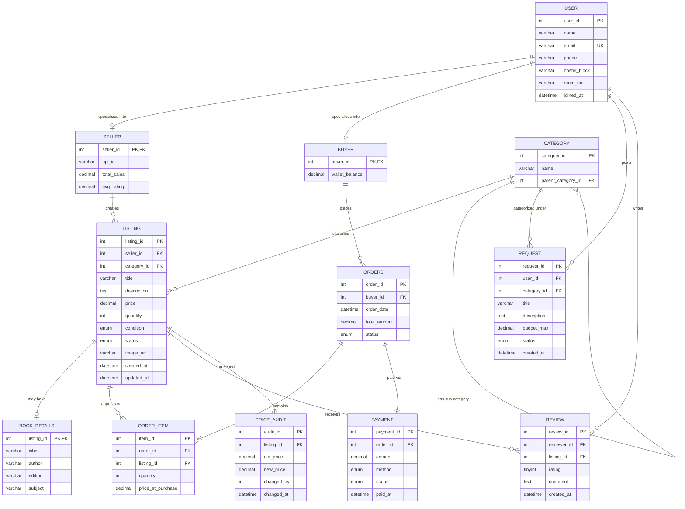

# CampusSwap — ER Design & Relational Mapping

> [!NOTE]
> This document covers **Stage 1** of the DBMS project: Entity-Relationship design, Mermaid ER diagram, and ER-to-relational mapping with viva-ready explanations.

---

## 1. Entities, Attributes, Keys & Relationships

### Entity List

| Entity | Primary Key | Key Attributes | Notes |
|--------|-------------|----------------|-------|
| **USER** | `user_id` | name, email (UNIQUE), phone, hostel_block, room_no, joined_at | Supertype for SELLER and BUYER |
| **SELLER** | `seller_id` (FK → USER) | upi_id, total_sales, avg_rating | Overlapping, partial specialization |
| **BUYER** | `buyer_id` (FK → USER) | wallet_balance | Overlapping, partial specialization |
| **CATEGORY** | `category_id` | name, parent_category_id (self-ref FK) | Tree structure for sub-categories |
| **LISTING** | `listing_id` | seller_id, category_id, title, description, price, quantity, condition, status, image_url, created_at, updated_at | Supertype for BOOK_DETAILS |
| **BOOK_DETAILS** | `listing_id` (FK → LISTING) | isbn, author, edition, subject | Specialization of LISTING |
| **ORDERS** | `order_id` | buyer_id, order_date, total_amount, status | Named ORDERS to avoid SQL keyword |
| **ORDER_ITEM** | `item_id` | order_id, listing_id, quantity, price_at_purchase | Resolves M:N between ORDERS and LISTING |
| **PAYMENT** | `payment_id` | order_id, amount, method, status, paid_at | One payment per order |
| **REQUEST** | `request_id` | user_id, category_id, title, description, budget_max, status, created_at | "Wanted" posts |
| **REVIEW** | `review_id` | reviewer_id, listing_id, rating (1–5), comment, created_at | One review per user per listing |
| **PRICE_AUDIT** | `audit_id` | listing_id, old_price, new_price, changed_by, changed_at | Audit trail for trigger |

### Relationship Cardinalities

| Relationship | Cardinality | Participation | Explanation |
|-------------|-------------|---------------|-------------|
| USER → SELLER | 1 : 0..1 | Partial | Not every user sells |
| USER → BUYER | 1 : 0..1 | Partial | Not every user buys |
| SELLER → LISTING | 1 : M | Total on LISTING side | Every listing must have a seller |
| CATEGORY → LISTING | 1 : M | Total on LISTING side | Every listing needs a category |
| CATEGORY → CATEGORY | 1 : M (self-ref) | Partial | Only sub-categories have a parent |
| LISTING → BOOK_DETAILS | 1 : 0..1 | Partial | Only book listings have details |
| BUYER → ORDERS | 1 : M | Total on ORDERS side | Every order has a buyer |
| ORDERS → ORDER_ITEM | 1 : M | Total on ORDER_ITEM side | Every item belongs to an order |
| LISTING → ORDER_ITEM | 1 : M | Partial | A listing may never be ordered |
| ORDERS → PAYMENT | 1 : 1 | Total | Every order has exactly one payment |
| USER → REQUEST | 1 : M | Partial | Not every user posts requests |
| USER → REVIEW | 1 : M | Partial | Not every user writes reviews |
| LISTING → REVIEW | 1 : M | Partial | Not every listing gets reviewed |

### Specialization Details

**USER → {SELLER, BUYER}**: **Overlapping, Partial**
- **Overlapping**: A student can be both a seller AND a buyer simultaneously (Ravi sells his old textbook AND buys a calculator)
- **Partial**: A newly registered user might be neither (just browsing)
- **Viva tip**: If it were *disjoint*, a user could only be one or the other. If it were *total*, every user MUST be at least one.

**LISTING → {BOOK_DETAILS}**: **Partial Specialization**
- Only book listings get extra attributes (ISBN, author, edition)
- Electronics, sports gear, etc. don't need these fields

---

## 2. ER Diagram (Mermaid)

---

## 3. ER-to-Relational Mapping Rules Applied

| ER Concept | Mapping Rule | Result |
|-----------|-------------|--------|
| **Strong Entity** (USER, CATEGORY, etc.) | Each becomes a table with its own PK | USER, CATEGORY, LISTING, ORDERS, etc. |
| **Overlapping Partial Specialization** (USER → SELLER, BUYER) | Create separate tables for subtypes with PK = FK to supertype | SELLER(seller_id FK→USER), BUYER(buyer_id FK→USER) |
| **Partial Specialization** (LISTING → BOOK_DETAILS) | Create child table with PK = FK to parent | BOOK_DETAILS(listing_id FK→LISTING) |
| **1:M Relationship** (SELLER → LISTING) | FK goes in the "many" side | LISTING has seller_id FK |
| **1:1 Relationship** (ORDERS → PAYMENT) | FK goes in the table with total participation, or either side | PAYMENT has order_id FK |
| **M:N Relationship** (ORDERS ↔ LISTING) | Create a junction table | ORDER_ITEM with FKs to both |
| **Self-referencing 1:M** (CATEGORY → CATEGORY) | FK in the same table pointing to its own PK | parent_category_id FK→category_id |
| **Weak Entity** | None in this schema | N/A |
| **Multi-valued Attribute** | None; we'd create a separate table if needed | N/A |

### Mapping Steps (Detailed)

1. **Step 1 — Map Strong Entities**: USER, CATEGORY → tables with all simple attributes
2. **Step 2 — Map Specializations**: 
   - USER → SELLER, BUYER (overlapping partial → separate tables, PK is FK)
   - LISTING → BOOK_DETAILS (partial → child table)
3. **Step 3 — Map 1:M Relationships**: Place FK on the "many" side
   - SELLER(1) → LISTING(M): `seller_id` FK in LISTING
   - BUYER(1) → ORDERS(M): `buyer_id` FK in ORDERS
   - USER(1) → REQUEST(M): `user_id` FK in REQUEST
   - USER(1) → REVIEW(M): `reviewer_id` FK in REVIEW
4. **Step 4 — Map 1:1 Relationships**: 
   - ORDERS(1) → PAYMENT(1): `order_id` FK in PAYMENT
5. **Step 5 — Map M:N Relationships**: 
   - ORDERS ↔ LISTING via ORDER_ITEM: `order_id` FK + `listing_id` FK
6. **Step 6 — Map Self-Referencing**: 
   - CATEGORY → CATEGORY: `parent_category_id` FK in same table
7. **Step 7 — Derived/Audit**: PRICE_AUDIT as a log table

---

## 4. Viva Questions on ER Design

**Q: Why is the USER→SELLER/BUYER specialization overlapping and partial?**
> Overlapping = one user can be both. Partial = not every user must be one. Example: Ravi sells books AND buys a calculator → he appears in both SELLER and BUYER tables.

**Q: Why not put seller/buyer attributes directly in the USER table?**
> That would waste space (NULL columns for non-sellers/non-buyers) and violate the principle of minimal redundancy. Separate tables keep it clean.

**Q: Why is ORDER_ITEM needed? Why not put listing_id directly in ORDERS?**
> One order can contain multiple items. Without ORDER_ITEM, we'd need repeating groups (violating 1NF) or multiple listing columns (bad design). ORDER_ITEM resolves the M:N relationship.

**Q: What does the self-referencing FK on CATEGORY achieve?**
> It creates a parent-child tree: Books → Engineering Books → CSE Books. Any depth is possible with the same structure.

**Q: Why store price_at_purchase in ORDER_ITEM instead of reading from LISTING?**
> The seller might change the price later. The order should record what the buyer actually paid — this is a historical fact that shouldn't change.
